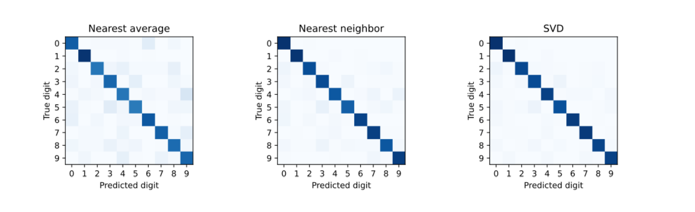

# Handwritten Digit Classification & Subspace Learning Engine

A comparative study of three linear algebra methods for classifying handwritten digits (0–9), built in MATLAB as a Numerical Linear Algebra course project.

## Overview

Different people write the same digit differently, so a classifier needs to recognize the underlying structure of a digit class rather than memorize individual examples. This project implements and benchmarks three classification approaches of increasing sophistication — from a single average vector per class, to comparing against every training example, to representing each class as a low-dimensional subspace via SVD — to see how accuracy and computational cost trade off against each other.

## Dataset

- **Source:** US Postal Service handwritten digit dataset
- **Training set:** 1,707 images (256-dimensional vectors, from 16×16 grayscale images)
- **Test set:** 2,007 images
- **Pixel values:** normalized to [-1, 1], where -1 is pure white and 1 is pure black
- **Class imbalance:** training examples are not evenly distributed across digits (e.g. 319 examples of '0' vs. only 88 of '5'), which affects per-digit accuracy below

## Methods

1. **Nearest Average (Nearest Centroid)** — represents each digit by the mean of its training images; a test image is assigned to the class with the closest mean. Extremely cheap (10 distance computations per prediction), but averaging blurs distinct handwriting styles into one blurred shape.

2. **Nearest Neighbor** — compares a test image against all 1,707 training images directly and takes the label of the closest one. Preserves individual handwriting styles, at the cost of comparing against the full training set every time (and being sensitive to atypical training examples).

3. **SVD Subspace Classifier (r = 15)** — computes the economy SVD of each digit class's training images and keeps the top 15 singular vectors as a basis for that class's subspace. A test image is assigned to the class whose subspace reconstructs it with the smallest residual error. r = 15 was chosen empirically: too small loses handwriting variation, too large causes different digits' subspaces to overlap.

## Results

| Method | Correct / Total | Accuracy | Execution time |
|---|:---:|:---:|:---:|
| Nearest Average | 1623 / 2007 | 80.87% | 0.02 s |
| Nearest Neighbor | 1838 / 2007 | 91.58% | 1.00 s |
| **SVD Subspace (r = 15)** | **1889 / 2007** | **94.12%** | 0.08 s |

SVD gives the best accuracy of the three while running roughly 12x faster than nearest-neighbor — representing each class as a subspace captures handwriting variation more effectively than a single average, without needing to store or search the entire training set.

**Error analysis:** nearest-average's two most common mistakes were confusing 0s with 6s (38 errors) and 4s with 9s (32 errors) — both pairs share a similar overall shape once reduced to an average image. Nearest-neighbor and SVD both reduce these errors substantially (SVD makes only 5 errors on 4→9), since they preserve more of each class's actual shape variation instead of collapsing it to one average.



## Project structure

```
├── src/
│   ├── recognizedigits.m   — main script: loads the data, runs all three classifiers,
│   │                         prints accuracy/timing/per-digit results, plots confusion matrices
│   └── plotdigit.m         — helper to render a single 256×1 image vector as a 16×16 digit
├── docs/
│   └── report.pdf          — full project report
├── confusion_matrices.png  — confusion matrix figure for all three methods
└── README.md
```

## How to run

```
git clone https://github.com/AlupuluiMarioStefan/Handwritten-Digit-Classification-Subspace-Learning-Engine.git
cd Handwritten-Digit-Classification-Subspace-Learning-Engine/src
```

Open in MATLAB (or GNU Octave) with `src/` as the working directory — make sure `digitimagesandlabels.mat` is present alongside the scripts — then run:

```matlab
recognizedigits
```

This loads the training/test data, trains and evaluates all three classifiers, prints accuracy, timing, and per-digit results to the console, and plots the confusion matrices shown above.

To visualize a single digit vector:

```matlab
load digitimagesandlabels
plotdigit(trainingimages(:, 1))
```

## Limitations

- The SVD subspace dimension (r = 15) was chosen empirically for this dataset and isn't guaranteed optimal for other handwriting data.
- Nearest-neighbor's accuracy comes at a real cost: it stores and searches the full training set for every prediction, which doesn't scale to larger datasets.
- The training set's class imbalance (see Dataset) likely contributes to some digits being classified more accurately than others, independent of how distinctive their shapes are.

## Acknowledgments

Originally developed as a group project for a Numerical Linear Algebra course assignment. AI assistance was used for LaTeX formatting of the original report (code formatting, figure placement) — not for the modeling, derivation, or code logic itself.
